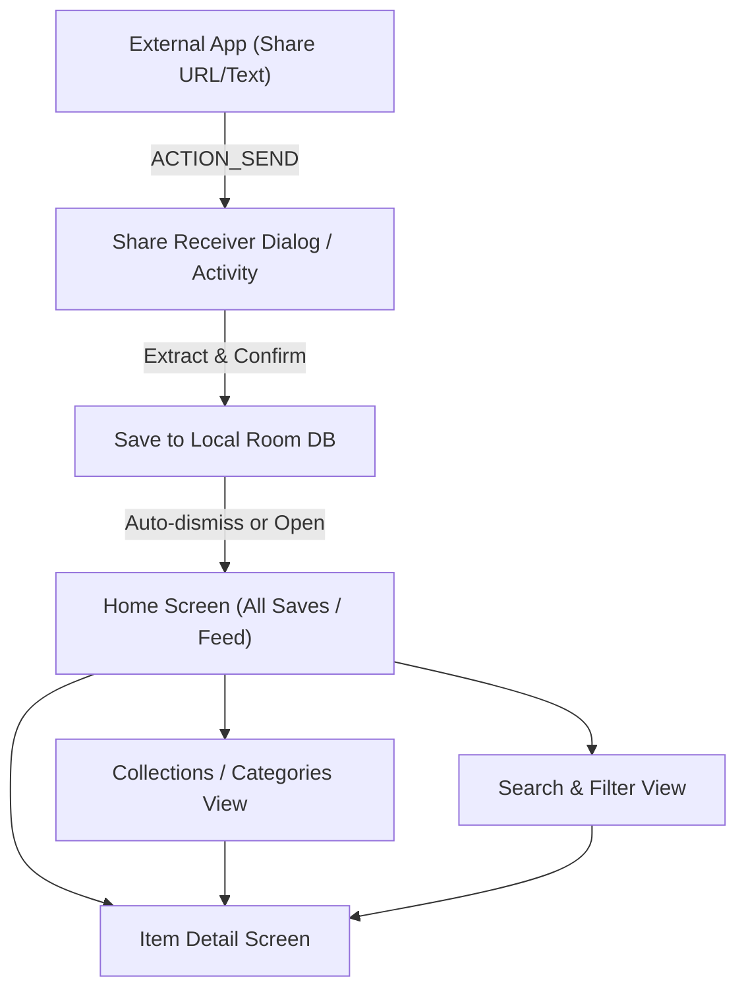

# App Flow: Laterly (Android Alternative)

This document defines verified, proposed, and implemented navigation flows for Laterly.

## Legend

- **[Verified]**: Observed from existing public metadata / artifacts.
- **[Proposed]**: Architecture for the open-source Android MVP.
- **[Implemented]**: Implemented and verified in code.

---

## High-Level Flow (Proposed MVP)

---

## Screen Definitions

### 1. Share Receiver Target [Proposed]

- **Purpose:** Receives shared text or URLs from system share sheet (`ACTION_SEND`, `text/plain`).
- **Entry:** Triggered by Android system share sheet from any browser or app.
- **User Actions:**
  - Displays quick preview (URL, fetched title/image if available).
  - Assigns or selects target collection/category.
  - Confirms Save or Cancels.
- **Exit:** Closes back to host app or navigates to Item Detail.
- **States:** Extracting metadata, editing tags, success toast/feedback.

### 2. Home Screen (Feed / All Saves) [Proposed]

- **Purpose:** Primary view displaying chronological list/grid of saved items.
- **Entry:** App launch via launcher icon.
- **User Actions:**
  - Tap item -> Open Item Detail Screen.
  - Search bar tap -> Navigate to Search View.
  - Category / Collection chip selection -> Filter view.
  - Floating Action Button (+) -> Manual URL / note entry.
- **States:** Empty state (instructions on how to share/save), loading, populated list.

### 3. Item Detail & Reader Screen [Implemented]

- **Purpose:** Inspect saved content details, notes, reading stats, and read full offline article content.
- **Entry:** Tap on any card in Home, Collections, or Search.
- **User Actions:**
  - Toggle between "Metadata & Notes" view and "Reader Mode" (full readable article text).
  - Tap "Visit Original Source" -> Launch system browser.
  - Edit personal notes & takeaways in-place.
  - Reassign collection.
  - Toggle favorite status.
  - Delete item with confirmation.
- **Exit:** Back navigation to calling list.

### 4. Search & Filter Screen [Proposed]

- **Purpose:** Fast query filtering across titles, descriptions, notes, and tags.
- **Entry:** Search bar tap on Home Screen.
- **User Actions:**
  - Type query -> Live query against local database.
  - Filter by media type (Link, Article, Video, Note).
- **Exit:** Clear query or back to Home.

### 5. Advanced / Future Screens (Deferred) [Proposed / Unverified]

- Map View (Places on map) — Requires location extraction and map SDK integration.
- Recipe / Grocery Planner — Requires domain-specific structured parsing.
- Social Sharing / Collaboration — Requires backend server infrastructure and auth.
